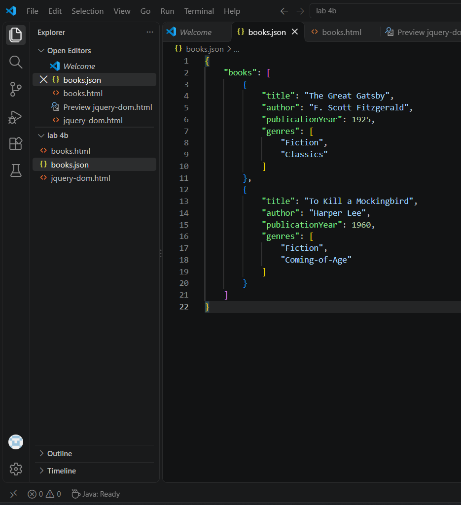
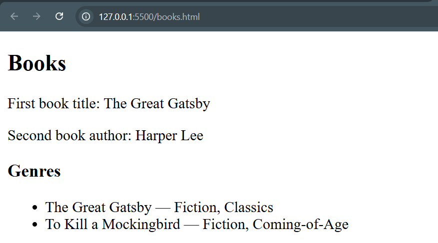
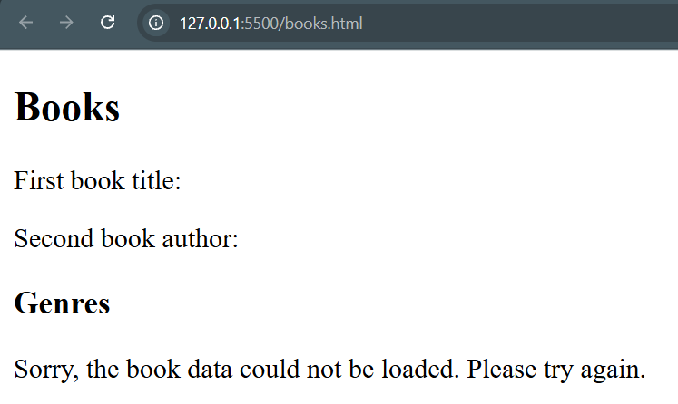
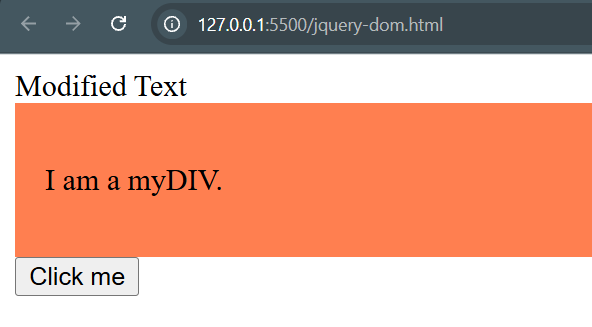
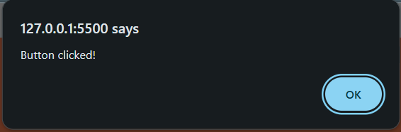

# BIC21203 Lab 4b - Client-Side Scripting (JSON and jQuery)

**Name:** AZRAEI AZKA BIN MOHD PAIZ
**Student ID:** AI240058

## Description

This lab contains three tasks that demonstrate JSON data handling, the native `fetch()` API, and jQuery DOM manipulation.

- **Q1 - Create and Structure JSON Data (`books.json`):** A JSON file with a top-level `books` array containing two book objects. Each book has a `title`, `author`, `publicationYear` and `genres` array.
- **Q2 - Retrieve and Display JSON Data (`books.html`):** Uses `fetch()` to read `books.json` and displays the title of the first book, the author of the second book, and the genres of both books on the web page. An error message is shown if the data cannot be loaded.
- **Q3 - Compare Native JavaScript and jQuery (`jquery-dom.html`):** Uses jQuery 4.0.0 to change text with `.text()`, add a CSS class with `.addClass()`, and handle a button click with `.on("click", ...)`.

## Setup Instructions

1. Clone or download this repository.
2. Open the folder in Visual Studio Code.
3. Install the **Live Server** extension (by Ritwick Dey).
4. Right-click the HTML file you want to run and select **Open with Live Server**.

**Q1 - `books.json`:** No setup needed. Open the file in a code editor to view the JSON.

**Q2 - `books.html`:** Must be run with Live Server (for example `http://127.0.0.1:5500/books.html`). Opening the file directly with `file://` will not work because `fetch()` cannot read local files that way. Keep `books.json` in the same folder as `books.html`.

**Q3 - `jquery-dom.html`:** Open with Live Server or open the file directly in a browser. An internet connection is required to load jQuery from the CDN.

## Screenshots

### Q1 - JSON Data

The complete `books.json` file:

JSON parsed successfully:

### Q2 - Retrieve and Display JSON Data

Output when the data loads successfully:

Error message when `books.json` cannot be loaded:

### Q3 - jQuery DOM and Events

Page after loading (text changed and class added):

Alert shown after clicking the button:

